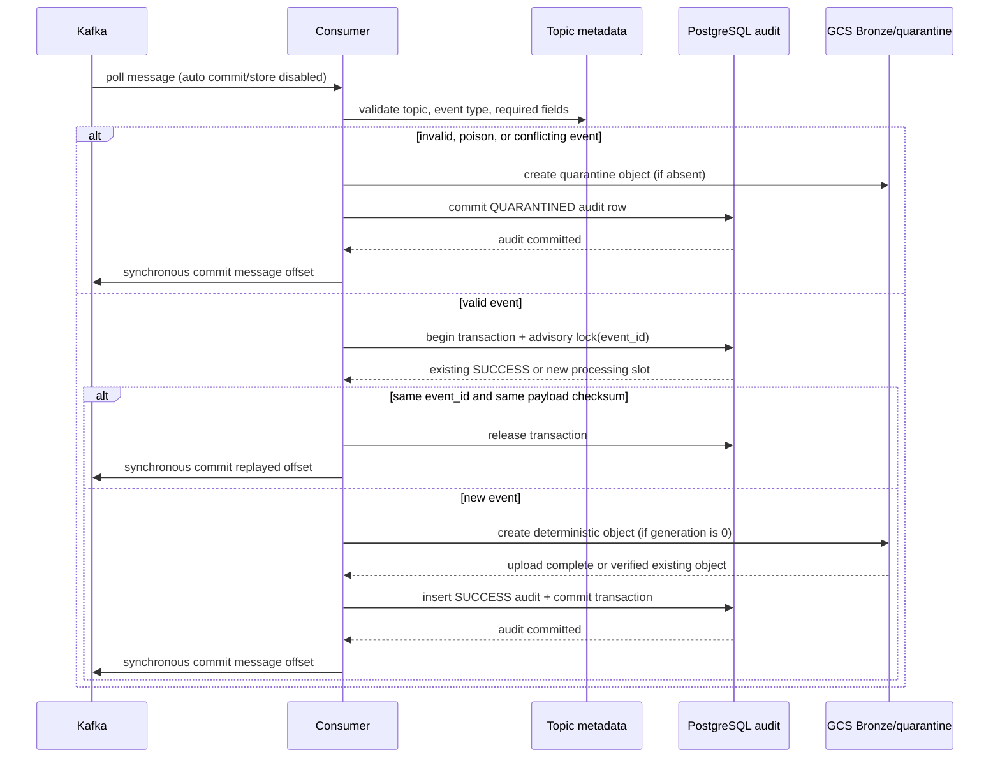
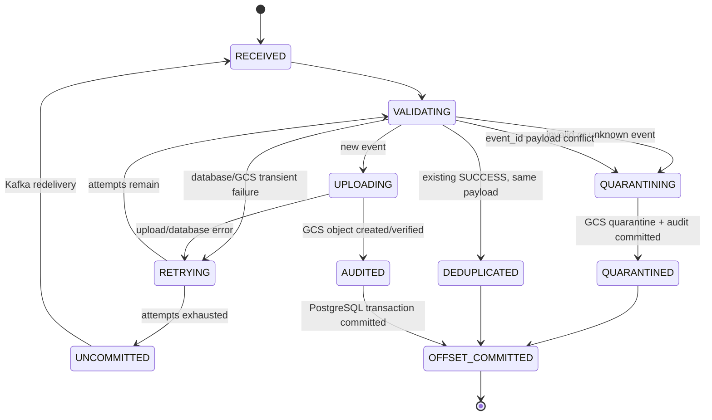

# Kafka-to-Bronze consumer

## Architecture

```text
Kafka topic
  -> metadata validation and normalization
  -> retryable PostgreSQL transaction (event-id advisory lock)
  -> create-only deterministic GCS Bronze object
  -> PostgreSQL SUCCESS audit commit
  -> synchronous Kafka offset commit
  -> independent Silver/Spark pipeline

Invalid or conflicting event
  -> deterministic GCS quarantine object
  -> PostgreSQL QUARANTINED audit commit
  -> synchronous Kafka offset commit
```

The consumer deliberately does not start Spark. Kafka-to-Bronze work is completed
before its offset is committed; Silver processing is a separate stage.





## Package layout

```text
dags/
  consumer.py                    Airflow DAG entry point
  producer.py                    Outbox producer; supplies event metadata headers
  kafka_consumer/
    config.py                     Environment and Kafka configuration
    topics.yaml                   Topics, allowed event types, required fields
    metadata.py                   Metadata loader
    message.py                    Validation and normalized event envelope
    retry.py                      Exponential retry policy
    storage.py                    Conditional GCS object writes
    audit.py                      Transactional PostgreSQL audit operations
    idempotency.py                Event-ID processing and quarantine service
    consumer.py                   Poll, rebalance, signal, and offset lifecycle
migrations/
  003_kafka_consumer_audit.sql   Audit table and indexes
tests/
  test_kafka_consumer.py
  integration/test_kafka_consumer_integration.py
```

## Delivery and idempotency guarantees

Kafka, PostgreSQL, and GCS do not participate in a shared distributed
transaction. Consequently this is **at-least-once delivery with effectively
once application effects**, not a claim of atomic exactly-once delivery across
all three systems:

* PostgreSQL transaction-scoped advisory locks serialize work for an
  `event_id`, including across partitions and consumer instances.
* A successful audit row stores the payload SHA-256, source position, status,
  GCS path, full-object checksum, retry count, and processing time.
* A Bronze object path is deterministic by topic, event type, the UTC date/hour
  and timestamp from `created_at`, and event ID. The `ingestion_time` folder
  therefore uses the event timestamp (rather than a fresh wall-clock time) so
  retries resolve to the same object. GCS `if_generation_match=0` prevents
  replacement. Existing objects are verified against their checksum before
  they are treated as already written.
* Bronze content does not include Kafka offset, so a replay of the same event
  produces identical bytes even when its offset differs.
* If the process crashes after GCS upload but before the PostgreSQL commit, the
  replay verifies the existing object and completes the audit. If it crashes
  after audit commit but before the Kafka commit, the replay sees SUCCESS and
  commits without uploading again.
* A repeated event ID with the same payload is skipped. A repeated event ID
  with a different payload is treated as corruption and written to quarantine.
* Kafka offsets are synchronously committed only after SUCCESS, duplicate
  detection, or durable quarantine. Transient errors after retries leave the
  offset uncommitted and fail the Airflow task.
* GCS object creation is atomic from readers' perspective. Resumable upload
  sessions that did not complete do not publish a visible final object; retry
  uses the create-only precondition.

## Failure/edge-case behavior

| Case | Result |
|---|---|
| Duplicate event ID, same payload, any offset/restart/rebalance | Audit lookup skips the effect; commit replayed offset |
| Duplicate event ID, different payload | Critical corruption log, deterministic quarantine object and audit; commit after durable quarantine |
| Crash before GCS write | DB transaction rolls back; offset remains uncommitted |
| Crash after GCS write, before audit commit | Replay verifies same deterministic object, then writes audit |
| Crash after audit commit, before Kafka commit | Replay finds SUCCESS and commits without a second object |
| GCS or PostgreSQL transient failure | Exponential backoff; after configured attempts, task fails and offset stays uncommitted |
| Invalid JSON, missing required field, unknown event type | GCS quarantine plus QUARANTINED audit; commit only after both |
| Kafka tombstone/null or empty byte value | Warn/skip and synchronously commit |
| Extra payload fields / optional fields | Preserved inside payload; consumer validates only required envelope fields |
| Poison input | Validation failure is quarantined rather than retried indefinitely |
| Rebalance or lost partition | No speculative revoke commit; prior per-message commits remain, in-flight work is replay-safe |
| Multiple consumers | Kafka group assignment plus PostgreSQL event-ID advisory lock protects against duplicate effects |
| Earliest/latest offset reset | Configurable; replay is deduplicated from PostgreSQL regardless |
| Broker/network/auth failure | Confluent client reconnects where possible; surfaced failures fail the task; no early offset commit |
| Slow GCS / large message | Processing blocks before offset commit; upload is bounded by request timeout; original bytes are not logged |
| Airflow retry / VM restart / graceful SIGTERM/SIGINT | Persisted audit and deterministic objects recover; current message completes before loop exit when possible |

Quarantine is the consumer's dead-letter implementation. Quarantine objects
are stored under `gs://<bucket>/quarantine/`; they include source topic,
partition, offset, validation reason, and the original bytes as base64. This
preserves malformed input without attempting to parse or overwrite it.

## Configuration and deployment

Set Kafka credentials and DB/GCS access using the existing Compose environment.
Optional consumer settings:

| Variable | Default | Meaning |
|---|---:|---|
| `KAFKA_AUTO_OFFSET_RESET` | `earliest` | `earliest` or `latest`, applies only with no committed group offset |
| `KAFKA_TOPICS` | all metadata topics | Comma-separated subset of topics defined in `topics.yaml` |
| `KAFKA_MAX_RETRIES` | `5` | Retries after the first attempt |
| `KAFKA_RETRY_BACKOFF_SECONDS` | `1` | Initial exponential delay |
| `KAFKA_RETRY_BACKOFF_MAX_SECONDS` | `30` | Retry delay ceiling |
| `KAFKA_POLL_TIMEOUT_SECONDS` | `1` | Kafka poll wait |
| `KAFKA_IDLE_TIMEOUT_SECONDS` | `30` | End a finite Airflow run after idle period |
| `KAFKA_MAX_MESSAGES` | `500` | Maximum messages per Airflow task run |
| `GCS_REQUEST_TIMEOUT_SECONDS` | `60` | Per GCS operation timeout |

Apply the audit migration once to the **simulator application database** before
unpausing/running `kafka_consumer`:

```bash
psql -h "$SIMULATOR_DB_HOST" \
  -p "${SIMULATOR_DB_PORT:-5432}" \
  -U "$SIMULATOR_DB_USER" \
  -d "$SIMULATOR_DB_NAME" \
  -v ON_ERROR_STOP=1 \
  -f migrations/003_kafka_consumer_audit.sql
```

Do not point this migration at Airflow's metadata database. Existing producer
messages must include `event_id`, `event_type`, `aggregate_id`, and `created_at`
headers; `dags/producer.py` now emits those headers from the outbox row. The
body is kept as the event `payload`.

## Tests

Run unit coverage:

```bash
python -m pytest tests/test_kafka_consumer.py
```

The real PostgreSQL + GCS replay integration test is opt-in. First apply the
migration, configure DB and GCS credentials, and use an isolated test bucket:

```bash
RUN_KAFKA_CONSUMER_INTEGRATION=1 \
GCS_BUCKET=your-isolated-test-bucket \
python -m pytest tests/integration/test_kafka_consumer_integration.py
```

The integration test creates a uniquely named event/object, verifies duplicate
replay, then removes only its own audit row and object.
